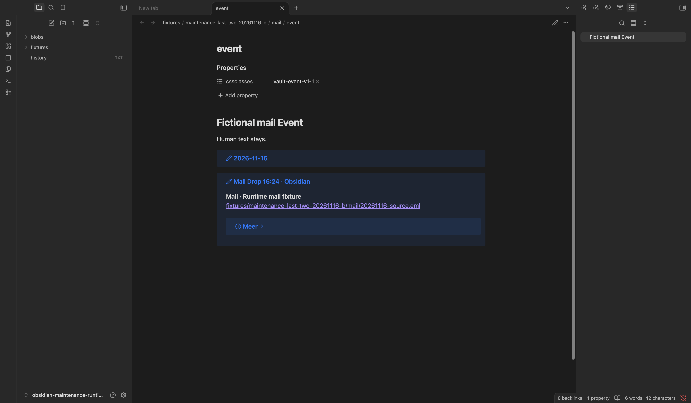
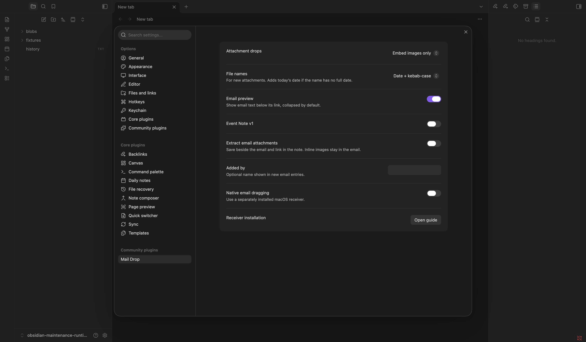

# Obsidian 1.15.1 maintenance candidate — 16 November 2026

Candidate `0.10.2` starts from public source `18cd8873cdc3bf0373379ce40790e4dfddd9af5c`, including the earlier provenance/renamed-source and Event Note inline-metadata work. The latest public release remains0.10.1. This candidate additionally uses Obsidian's active document for initial drop listeners and a targetless-drop fallback; a drop target's own document and existing per-window registration remain preferred where present. It updates official lint to0.6.0 without changing native receiver source.

Local locked install, official lint,62tests, TypeScript/production build, universal macOS receiver build and release review-checks passed. Native checks cover the existing four self-test modes, including synthetic pasteboard/materialization behavior; they do not prove a real Outlook or Apple Mail drag. Production dependency audit is recorded separately. The intentional legacy-file-promise native deprecation warning remains.

The actual release bundle also passed a headless integration test using a minimal Obsidian API and an own fictional filesystem vault. It checks active-document listeners when the legacy document differs, default native receiver off, no missing-receiver startup notice, import preview/H1, retained human text, exact original EML bytes, repeat deduplication, empty-input preservation, missing optional receiver handling and settings. Replacing activeDocument with document in a temporary in-memory negative control fails the specific listener oracle. This is not an actual Obsidian window, native provider or popout test.

Production main.js SHA-256: `673060ba7a791f5df0a6c40ece3a642dcf0dd7f31042349ad2dbd54e997bd258`. Universal receiver SHA-256: `5a36c64960ec916a97ccf7b4bbbd80262bb39b8b4b931a2b4634afe84431ef44`, unchanged from0.10.1. A matching receiver does not by itself validate the changed standard bundle/provider combination.

Actual Obsidian1.15.1 on macOS desktop passed in a separate synthetic vault, own user-data profile and independently isolated CLI socket. A synthetic File/DataTransfer drop dispatched to the real Markdown editor exercised document capture and the actual Vault API import. Assertions covered original EML bytes, retained human text, inline Event/provenance metadata, nested From, real Markdown preview, renamed byte-identical retry without duplicate mail and empty-input preservation. Settings were saved/restored and plugin unload/reload retained default native-off behavior. A focused valid Event fixture with its required Activity heading subsequently passed the ViggVault Activity Worker with exact note/EML hashes and report path. This interoperability receipt binds the earlier ViggVault bundle, not its later WASM replacement.

The same exact Mail bundle additionally passed actual1.15.1 Settings renderTab/getSettingDefinitions control callbacks: Email preview true→false→true persisted. The legacy display/renderControls branch passed the same roundtrip on1.15.1; this does not prove an earlier Obsidian version. A transparent temporary routing override kept Settings in the own main renderer rather than a native popout, with the original method restored afterward. No OS mouse/keyboard input was used. Native email dragging stayed off throughout; settings were restored and command registrations disappeared on unload. The ordinary app's CLI owner, socket inode/version response and original app hashes remained unchanged before/during/after, and the own host/children stopped.

Real Outlook/Apple Mail provider input and native receiver interaction were not retested for this candidate/version; the earlier1.15.0 Outlook proof is not claimed as1.15.1 acceptance. Standard Community delivery consists of main.js, manifest.json and styles.css; the optional receiver remains separately installed and unchanged. The maintained provider limitation is explicit rather than a claim of universal compatibility. Independent exact-source/runtime review, official source/release review, immutable public asset readback and fresh Community installation remain separate gates. Issue#11 remains open until delivery acceptance is evidenced.

