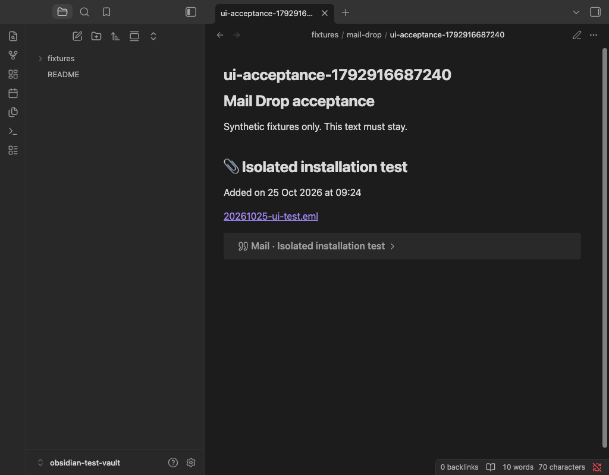
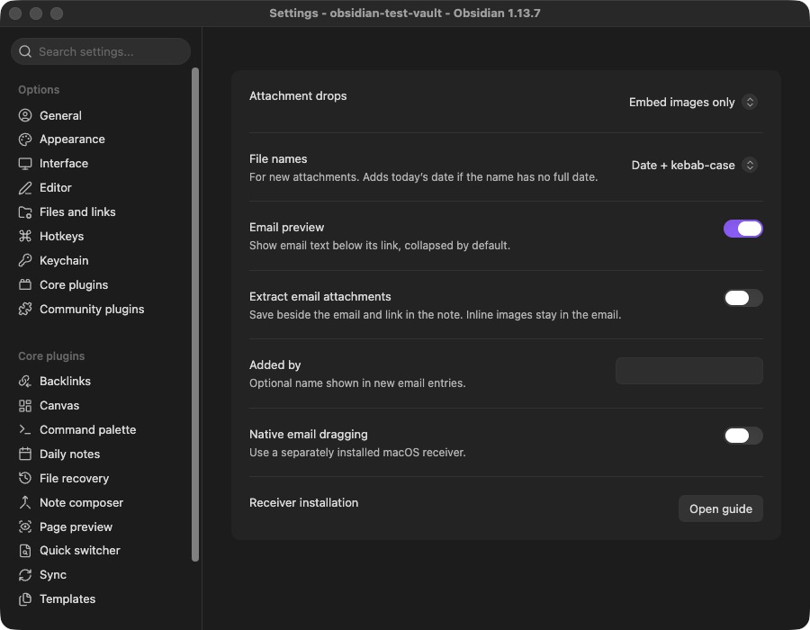

# 0.9.1 candidate validation

Validated on 25 October 2026 on macOS / Apple Silicon with Obsidian 1.13.7. The official preview of commit `94024d7` completed without errors and passed dependency checks. It reported five advisory unsafe-type rule groups; most locations involve Node APIs or newer standard-library definitions that the scanner does not resolve as the local typed build does. No 0.9.1 release has been published.

- Clean plain `npm ci`: passed, zero known vulnerabilities. The first Community preview of commit `eb456e8` found missing peer dependencies in the lockfile; it was regenerated with ordinary `npm install`, and the plain clean installation was rechecked.
- Official recommended Obsidian ESLint configuration: zero errors and warnings.
- 56 regression tests, TypeScript, minified build and universal macOS receiver build: passed.
- Native classifier, pasteboard, completion and two-message watcher checks: passed.
- Release bundle AST: no `eval` or `new Function`; required files and minimum Obsidian 1.5.7 checked.
- Actual bundle in an isolated filesystem vault with a minimal mocked Obsidian host: 11 checks passed. This is headless integration evidence, not an application/provider test.
- Separate real Obsidian test vault, installed with only `main.js`, `manifest.json`, `styles.css` and fresh settings: 11 checks passed. No receiver was bundled in that vault.

The real application checks cover startup with native reception off, functional settings controls, a synthetic browser-file drop through the registered DOM handler, paperclip H1 and collapsed preview, human text and exact-byte preservation, repeat deduplication, empty-file failure without note changes, graceful missing-helper handling, explicit external receiver connection and stopping its child process when disabled.

The application check found and repaired an additional settings regression: names-only setting definitions hide imperative controls on newer Obsidian. Definitions now provide render callbacks, sharing the same controls with the legacy display fallback. Local lint alone had not detected this behavior.

These are synthetic mail fixtures. This round does not claim new actual Apple Mail/Outlook provider drags, an Intel runtime test, Apple notarization, or a runtime test on Obsidian 1.5.7. The declared minimum is based on API inspection and lint; legacy rendering remains supported in source.

The optional receiver is manually installed and explicitly enabled. Standard file imports work independently. Final source/release verification and the listing publication decision remain separate gates. Automated source scanning does not constitute a human endorsement of the native dependency model.

The follow-up candidate explicitly declares ES2020/DOM libraries and Node types. Its standard plugin build is separate from the optional macOS receiver build, so building `main.js` does not require Swift or a Mac. Both artifact locations contain the same tested bundle bytes. The scanner's Node-type limitation is also reported in [the official ESLint repository, issue 178](https://github.com/obsidianmd/eslint-plugin/issues/178); local strict typed lint remains enabled without suppressions.
